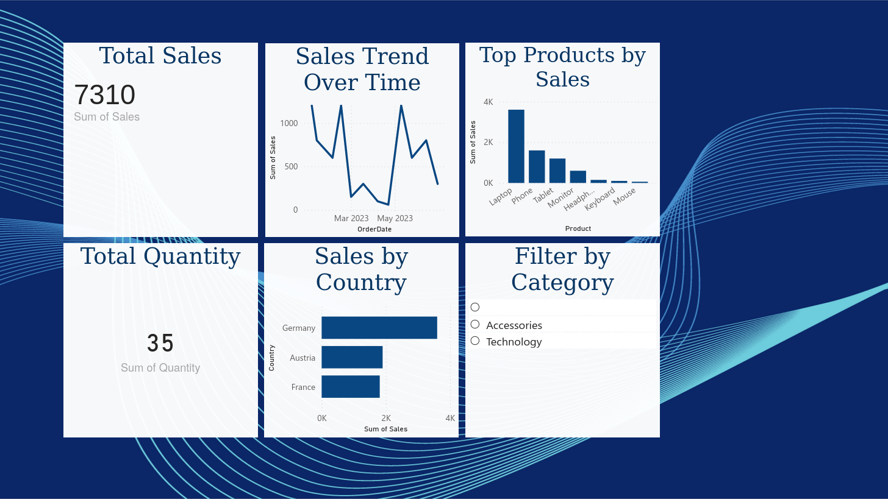

# 📊 Sales Performance Dashboard (Power BI)

## 📌 Project Overview
This project presents an **interactive sales performance dashboard** built using **Power BI**.  
The dashboard provides a clear overview of business performance by visualizing key sales metrics, trends, and comparisons.

The goal of this project is to demonstrate **business intelligence and data visualization skills** suitable for a **junior data analyst role**.

---

## 🎯 Objectives
- Analyze overall sales performance
- Track sales trends over time
- Compare sales across countries and products
- Enable interactive filtering for deeper insights

---

## 📈 Key Metrics (KPIs)
- **Total Sales**
- **Total Quantity Sold**

---

## 📊 Dashboard Visuals
- **Sales Trend Over Time** (Line Chart)
- **Sales by Country** (Bar Chart)
- **Top Products by Sales** (Column Chart)
- **Category Filter** (Slicer for interactivity)

---

## 🛠 Tools & Technologies
- **Power BI**
- **CSV Dataset**
- **Git & GitHub**

---

## 📂 Project Structure

```
powerbi-sales-dashboard/
│
├── data/
│ └── sales.csv
│
├── dashboard/
│ └── dashboard_overview.png
│
└── README.md
```

---

## 📊 Dashboard Preview


---

## 🧠 Insights Gained
- Identified top-performing countries and products
- Observed sales fluctuations over time
- Enabled dynamic analysis using category-based filtering

---

## 🚀 Outcome
This project showcases the ability to:
- Build interactive dashboards
- Translate raw data into business insights
- Communicate results visually for decision-making

---

## 👤 Author
**Abdelhamid Moltazim**  
Data Analyst
